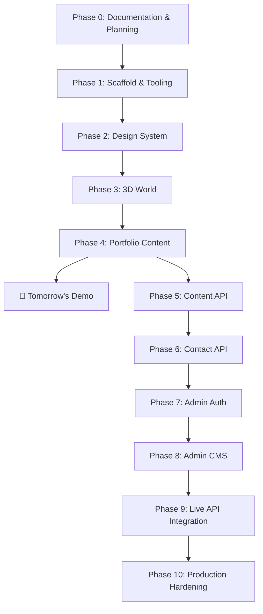

# Implementation Plan — Najath Muhammad Portfolio

> **Status**: Phase 0 — Documentation complete. Awaiting approval to begin implementation.
> This plan separates features into independently testable phases ordered by delivery priority.

---

## Overview



---

## Tomorrow's Demo Scope

> The demo must be **presentable and running locally** by tomorrow.
> It may use accurate typed local data — the backend CMS is not required for the demo.

### Demo Must-Haves ✅

| Item | Description |
|------|-------------|
| Premium dark 3D landing page | Isometric scene with glowing cyan paths, luminous core, 3D section objects |
| Clickable 3D navigation | Each 3D object navigates to its section |
| Conventional navigation | Top nav or sidebar for non-3D users |
| About page | Professional summary, skills, education |
| Projects page | All 5 main projects with accurate CV descriptions |
| Individual project pages | `/projects/[slug]` with accurate content |
| Resume page | Formatted CV view |
| Contact page | Form (static for demo, backend not required) |
| Non-3D fallback | Works without WebGL, respects reduced-motion |
| Passing production build | `next build` succeeds without errors |

### Demo Nice-to-Haves (if time allows)

| Item | Description |
|------|-------------|
| Contact form backend | Express API + MongoDB storing messages |
| Admin login | JWT-protected `/admin` login |

---

## Phase 0 — Documentation & Planning

**Branch**: `feature/project-knowledge-base`
**Status**: ✅ In progress (this document)

### Deliverables

| File | Description |
|------|-------------|
| `docs/PORTFOLIO_SOURCE_OF_TRUTH.md` | Canonical CV data, publication tracker |
| `docs/PROJECT_RULES.md` | Product vision, architecture, security, Git, quality rules |
| `docs/IMPLEMENTATION_PLAN.md` | This document |

### Acceptance Criteria

- [x] Source-of-truth contains every CV section and bullet.
- [x] Project rules include all required architecture, Git, security, and quality requirements.
- [x] Implementation plan separates features into independently testable phases.
- [x] Three documents reviewed for omissions and contradictions.
- [ ] **Najath approves all three documents before implementation begins.**

---

## Phase 1 — Project Scaffold & Quality Tooling

**Branch**: `feature/project-scaffold` → then `feature/quality-tooling`

### Goals

- Initialize the monorepo structure.
- Bootstrap the Next.js frontend and Express backend.
- Configure TypeScript strictly for both.
- Set up ESLint, Prettier, and testing infrastructure.
- Configure environment-based settings.
- Set up GitHub Actions CI pipeline.

### Directory Structure

```
portfolio/
├── apps/
│   ├── web/                    ← Next.js frontend (TypeScript)
│   └── api/                    ← Express backend (TypeScript)
├── docs/                       ← Documentation (this phase: done)
├── .github/
│   └── workflows/
│       └── ci.yml              ← Lint, type-check, test on PR
├── .env.example                ← All required env vars documented
├── .gitignore
├── package.json                ← Workspace root (npm workspaces or turbo)
└── README.md
```

### Key Files

**`apps/web/`** (Next.js App Router)
```
src/
├── app/
│   ├── layout.tsx
│   ├── page.tsx                ← Landing / 3D world
│   ├── about/page.tsx
│   ├── projects/page.tsx
│   ├── projects/[slug]/page.tsx
│   ├── resume/page.tsx
│   ├── contact/page.tsx
│   └── admin/                  ← Admin routes (later phases)
├── components/
├── lib/
├── data/                       ← Typed local data for demo
├── types/
└── styles/
```

**`apps/api/`** (Express)
```
src/
├── controllers/
├── services/
├── repositories/
├── routes/
├── middleware/
├── models/
├── dto/
├── mappers/
├── validators/
├── constants/
├── errors/
├── responses/
├── config/
└── composition/
```

### Acceptance Criteria

- [ ] `npm run dev` starts both frontend (port 3000) and backend (port 5000) in one command.
- [ ] `npm run lint` passes with zero errors.
- [ ] `npx tsc --noEmit` passes for both apps.
- [ ] `npm test` runs and passes (even if only a smoke test exists).
- [ ] `next build` produces a successful production build.
- [ ] `.env.example` documents all required environment variables.
- [ ] No secrets committed to Git.

### Test Strategy

- Run `tsc --noEmit` for both apps.
- Run ESLint across all `ts` and `tsx` files.
- Smoke test: `next build` must exit with code 0.

---

## Phase 2 — Design System

**Branch**: `feature/portfolio-design-system`

### Goals

- Configure Tailwind CSS with custom design tokens matching the dark/futuristic aesthetic.
- Set up Google Fonts (Inter or a premium geometric sans-serif).
- Establish color palette: near-black backgrounds, cyan accents, neutral grays.
- Create global CSS with resets, utility classes, and animation keyframes.
- Build foundational UI components: Button, Card, Badge, Section, Typography.
- Establish consistent spacing, border-radius, and shadow scales.

### Design Tokens (Tailwind `tailwind.config.ts`)

```ts
colors: {
  bg: {
    primary:   '#080c10',   // near-black
    secondary: '#0d1117',
    surface:   '#161b22',
  },
  cyan: {
    glow:   '#00fff5',
    accent: '#00d4e8',
    dim:    '#00a3b4',
  },
  neutral: {
    100: '#e6edf3',
    200: '#8b949e',
    300: '#484f58',
    400: '#30363d',
  },
}
```

### Acceptance Criteria

- [ ] Tailwind extended config committed and applied globally.
- [ ] Google Font loaded correctly (no FOUT).
- [ ] All base UI components render correctly.
- [ ] Responsive breakpoints verified at mobile, tablet, and desktop widths.
- [ ] Dark background and cyan accent visible on all pages.
- [ ] Micro-animation keyframes defined (`float`, `pulse-glow`, `fade-in`).

### Test Strategy

- Visual inspection at mobile (375px), tablet (768px), and desktop (1440px).
- Run ESLint and TypeScript checks after completing components.

---

## Phase 3 — Interactive 3D World

**Branch**: `feature/interactive-3d-world`

### Goals

- Build the isometric 3D landing scene using React Three Fiber and Three.js.
- Implement procedural geometry for all section objects (no complex imported models required).
- Add glowing cyan circuit paths between objects.
- Add a luminous central core.
- Wire click handlers to route to the correct section.
- Implement `prefers-reduced-motion` and WebGL availability detection.
- Implement non-3D fallback layout (standard hero + nav cards).
- Lazy-load the entire 3D scene.

### Scene Objects & Routes

| 3D Object | Label | Route |
|-----------|-------|-------|
| Hexagonal prism | WORKS | `/projects` |
| Circuit board slab | SKILLS | `/about#skills` |
| Tower/column | EXPERIENCE | `/about#experience` |
| Globe / head | ABOUT ME | `/about` |
| Document/plane | RESUME | `/resume` |
| Envelope/funnel | CONTACT | `/contact` |
| Central processor | [Core] | `/` |

### Technical Approach

```tsx
// Procedural geometry examples
// WORKS — ExtrudeGeometry from hexagonal shape
// SKILLS — BoxGeometry with circuit texture
// EXPERIENCE — CylinderGeometry stack
// CONTACT — TorusGeometry or custom lathe
// Paths — TubeGeometry or Line with dashedMaterial
// Core — IcosahedronGeometry with emissive material + PointLight
```

### Acceptance Criteria

- [ ] 3D scene renders on desktop without errors.
- [ ] Clicking each 3D object navigates to the correct route.
- [ ] Non-3D fallback renders when WebGL is unavailable or `prefers-reduced-motion` is active.
- [ ] Scene lazy-loads (does not block initial paint).
- [ ] Conventional top navigation works independently of the 3D scene.
- [ ] Ambient glow and circuit paths are visible and aesthetically correct.
- [ ] No console errors or unhandled Three.js exceptions.

### Test Strategy

- Visual inspection in Chrome, Firefox, and Safari.
- Test with WebGL disabled (use browser flags or `jest-canvas-mock` for unit tests).
- Test with `prefers-reduced-motion: reduce` media query active.
- Run TypeScript checks after 3D component implementation.

---

## Phase 4 — Portfolio Content Pages

**Branch**: `feature/project-showcase`

### Goals

- Build all public-facing pages with accurate CV content.
- Source all content from typed local data files (matching `PORTFOLIO_SOURCE_OF_TRUTH.md`).
- Build individual project case study pages (`/projects/[slug]`).
- Build About page (summary, skills grid, experience timeline, education).
- Build Resume page (formatted, printable).
- Build Contact page (form with validation, static for demo).
- Implement all content from `PORTFOLIO_SOURCE_OF_TRUTH.md` without omissions or inventions.

### Typed Local Data Structure

```ts
// apps/web/src/data/projects.ts
export const projects: Project[] = [
  {
    slug: 'rentnride',
    title: 'RentNRide',
    subtitle: 'Vehicle Rental Platform',
    technologies: ['TypeScript', 'MERN', 'Docker', 'Redis', 'Socket.IO', 'Razorpay', 'Cloudinary'],
    bullets: [...],
    liveUrl: null,   // NEEDS VERIFICATION
    githubUrl: null, // NEEDS VERIFICATION
    featured: true,
  },
  // ... other projects
]
```

### Pages

| Route | Component | Data Source |
|-------|-----------|-------------|
| `/` | `HomePage` | Static |
| `/about` | `AboutPage` | `data/profile.ts`, `data/skills.ts`, `data/experience.ts` |
| `/projects` | `ProjectsPage` | `data/projects.ts` |
| `/projects/[slug]` | `ProjectPage` | `data/projects.ts` |
| `/resume` | `ResumePage` | All data files |
| `/contact` | `ContactPage` | Static form |

### Acceptance Criteria

- [ ] Every CV section and bullet from `PORTFOLIO_SOURCE_OF_TRUTH.md` appears on the site.
- [ ] No invented content (awards, metrics, URLs, technologies).
- [ ] `[NEEDS VERIFICATION]` fields rendered as "Coming Soon" or hidden — never as fake data.
- [ ] All 5 main projects and 2 secondary projects displayed.
- [ ] Individual project pages for all 5 main projects resolve without 404.
- [ ] Resume page is readable and printable.
- [ ] Contact form validates client-side and shows appropriate states.
- [ ] All pages pass TypeScript checks.
- [ ] `next build` succeeds.

### Test Strategy

- Cross-reference every content item against `PORTFOLIO_SOURCE_OF_TRUTH.md` manually.
- Test 404 handling for invalid slugs.
- Test contact form validation (empty, invalid email, valid submission).
- Run `tsc --noEmit` and ESLint.

---

## Phase 5 — Portfolio Content API

**Branch**: `feature/portfolio-content-api`

### Goals

- Build Express REST API endpoints for public content.
- Implement MongoDB models for projects, skills, and experience.
- Follow the full controller/service/repository architecture.
- DTOs and mappers ensure only published content is served.
- Seed the database from the typed local data.

### Public API Endpoints

| Method | Route | Description |
|--------|-------|-------------|
| GET | `/api/projects` | List all published projects |
| GET | `/api/projects/:slug` | Get single project by slug |
| GET | `/api/skills` | List all skills |
| GET | `/api/experience` | List all experience entries |
| GET | `/api/profile` | Get profile/about data |

### Acceptance Criteria

- [ ] All endpoints return correct, published-only data.
- [ ] Unpublished content is excluded from public responses.
- [ ] Database documents are never serialized directly (DTOs/mappers used).
- [ ] Zod validation on all query parameters.
- [ ] API returns appropriate HTTP status codes.
- [ ] Integration tests pass for all endpoints.

### Test Strategy

- Unit tests for service and repository layers.
- Integration tests using `supertest` for each endpoint.
- Verify with `curl` or Postman that unpublished content is hidden.

---

## Phase 6 — Contact API

**Branch**: `feature/contact-api`

### Goals

- Build the contact form POST endpoint.
- Store messages in MongoDB.
- Rate-limit the contact endpoint.
- Sanitize input; never expose raw error messages.

### Endpoint

| Method | Route | Description |
|--------|-------|-------------|
| POST | `/api/contact` | Submit a contact message |

### Validation Schema (Zod)

```ts
z.object({
  name:    z.string().min(2).max(100),
  email:   z.email(),
  subject: z.string().min(2).max(200),
  message: z.string().min(10).max(2000),
})
```

### Acceptance Criteria

- [ ] Valid submissions are stored in MongoDB.
- [ ] Rate limiting blocks more than N requests per IP per window.
- [ ] Invalid input returns 400 with field-level error details.
- [ ] No raw error or stack trace exposed in the response.
- [ ] Messages visible in admin dashboard (Phase 8).

### Test Strategy

- Unit tests for ContactService and ContactRepository.
- Integration tests: valid submission, invalid input, rate limit trigger.

---

## Phase 7 — Admin Authentication

**Branch**: `feature/admin-authentication`

### Goals

- Build admin login endpoint with secure password comparison (bcrypt).
- Issue JWT access tokens with appropriate expiry.
- Implement auth middleware for all `/admin` API routes.
- Build `/admin/login` frontend page.
- Implement logout with server-side token invalidation.
- Rate-limit the login endpoint.

### Acceptance Criteria

- [ ] Admin can log in with valid credentials.
- [ ] Invalid credentials return 401 (not 403 or 200).
- [ ] JWT is stored securely (HttpOnly cookie preferred).
- [ ] All protected API routes return 401 without a valid token.
- [ ] Logout invalidates the session server-side.
- [ ] Login endpoint is rate-limited.
- [ ] Password is hashed in the database (bcrypt, cost ≥ 12).
- [ ] No credentials, tokens, or secrets appear in logs or responses.

### Test Strategy

- Unit tests for AuthService (password comparison, token generation).
- Integration tests: valid login, invalid password, missing token on protected route.
- Verify JWT is not stored in localStorage (check frontend code).

---

## Phase 8 — Admin CMS

**Branches**: `feature/admin-project-editor`, `feature/admin-skills-editor`, `feature/admin-profile-editor`, `feature/admin-content-publishing`

### Goals

- Build admin dashboard UI.
- CRUD for projects, skills, and experience.
- Profile editor.
- Messages inbox (read-only).
- Draft/publish workflow for projects.
- Server-side pagination, sorting, and filtering.
- Cloudinary upload integration for project images.

### Admin Pages

| Route | Feature |
|-------|---------|
| `/admin` | Dashboard with summary cards |
| `/admin/projects` | Project list, create, edit, delete, publish/draft |
| `/admin/skills` | Skills list, add, edit, delete |
| `/admin/experience` | Experience list, add, edit, delete |
| `/admin/profile` | Edit profile/about content |
| `/admin/messages` | Read contact messages |

### Acceptance Criteria

- [ ] All admin routes protected — 401 redirect if not authenticated.
- [ ] CRUD operations reflected immediately in admin UI.
- [ ] Published/draft toggle updates public API visibility.
- [ ] Pagination works for projects list.
- [ ] File upload validates type (image/*) and size (max 5MB).
- [ ] Duplicate form submissions prevented.
- [ ] All admin API endpoints server-side validated.

### Test Strategy

- Unit tests for admin service and repository layers.
- Integration tests for create, read, update, delete, and publish/draft flow.
- Test unauthorized access to all admin endpoints.

---

## Phase 9 — Live API Integration

**Branch**: `feature/public-api-integration`

### Goals

- Replace all typed local data in the Next.js frontend with live API calls.
- Implement loading, error, empty, and retry states on all pages.
- Use server-side rendering (SSR) or static generation (SSG) where appropriate for SEO.

### Acceptance Criteria

- [ ] All public pages source data from the live API.
- [ ] Loading states shown during data fetches.
- [ ] Error states shown with retry option on failure.
- [ ] Empty states shown when no data is available.
- [ ] SEO meta tags populated with live data.
- [ ] No hardcoded data remaining in frontend.

### Test Strategy

- Test with API server stopped (error state must render).
- Test with empty database (empty state must render).
- Run `next build` with `NEXT_PUBLIC_API_URL` pointed at the real API.

---

## Phase 10 — Production Hardening

**Branch**: `feature/production-hardening`

### Goals

- Security headers (Content-Security-Policy, HSTS, X-Frame-Options, etc.).
- Final rate limiting review.
- Helmet.js configuration for Express.
- CORS locked to production domain.
- Error boundary components in React.
- Performance audit (Lighthouse ≥ 90).
- Documented production deployment process (README).
- Environment variable audit — no secrets in code.
- Final `next build` and TypeScript clean pass.

### Acceptance Criteria

- [ ] Lighthouse scores: Performance ≥ 90, Accessibility ≥ 90, SEO ≥ 90.
- [ ] No secrets in Git history or client bundles.
- [ ] Security headers present on all responses.
- [ ] CORS restricts to the production domain.
- [ ] `next build` and `tsc --noEmit` both exit with code 0.
- [ ] Production deployment process documented in README.
- [ ] All environment variables documented in `.env.example`.

### Test Strategy

- Run `next build` in production mode.
- Run Lighthouse CI or manual Lighthouse audit.
- Run `npm audit` and address critical/high vulnerabilities.
- Verify headers using `curl -I` against the deployed URL.

---

## Risk Register

| Risk | Likelihood | Impact | Mitigation |
|------|-----------|--------|------------|
| WebGL performance on low-end devices | Medium | High | Non-3D fallback (Phase 3) |
| 3D scene delays page load | Medium | High | Lazy load + Suspense + static fallback |
| Content accuracy errors | Low | High | Cross-check all content against source-of-truth |
| [NEEDS VERIFICATION] items shown as fake data | Low | High | Render as "Coming Soon" or hide entirely |
| Backend complexity delays demo | Medium | Medium | Demo uses typed local data (Phase 4) |
| MongoDB/Redis not available locally | Low | Medium | `.env.example` and README setup guide |

---

## Definition of Done

A phase is **done** when:

1. All acceptance criteria are checked off.
2. ESLint passes with zero errors.
3. TypeScript checks pass with zero errors.
4. Relevant tests pass.
5. `next build` (and backend `tsc`) succeed.
6. The feature branch is committed and ready for review.
7. No secrets are present in committed code.
8. Any unresolved items are documented.

---

*Awaiting approval from Najath Muhammad to begin Phase 1.*
